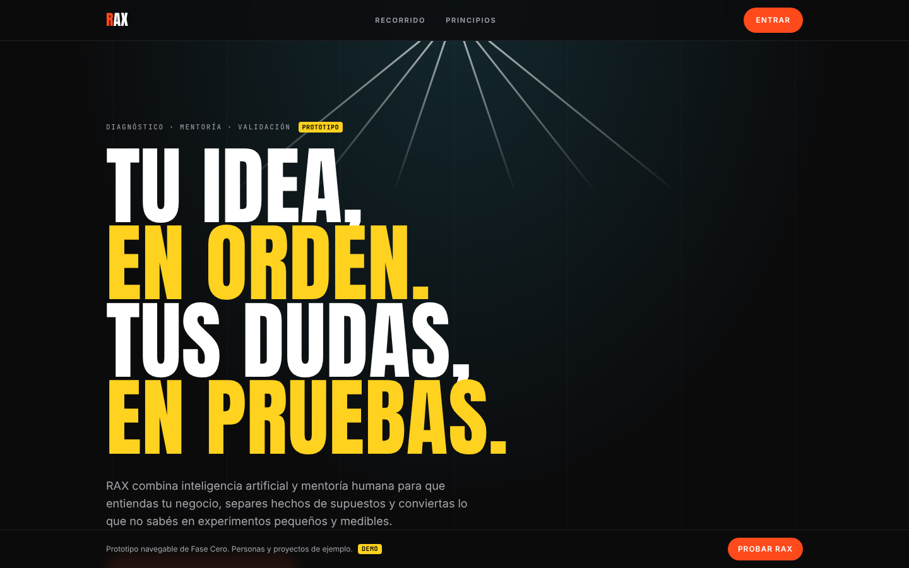
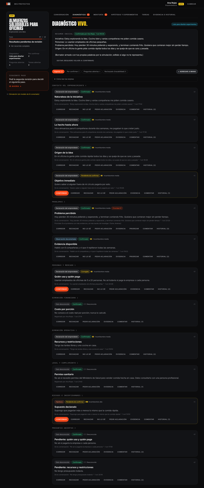
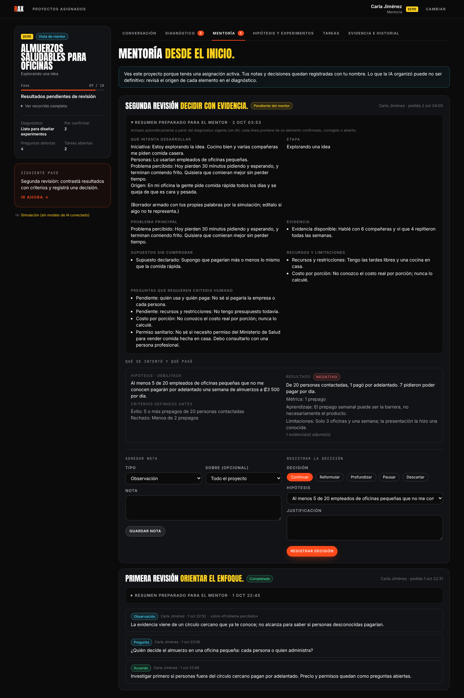
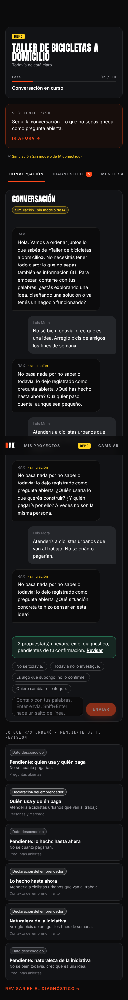

# RAX · Fase Cero

RAX ayuda a emprendedores a pasar de una idea confusa a un diagnóstico ordenado, hipótesis comprobables y experimentos con criterios fijados de antemano. La IA estructura lo que la persona dice (no inventa), y un mentor humano revisa desde el inicio: primera revisión del diagnóstico y segunda revisión de los resultados.

> **Estado: prototipo funcional, no listo para producción.** Usa Supabase de verdad (Auth con correo y contraseña, Postgres con RLS). Ya no hay modo DEMO ni datos de ejemplo. Ver [docs/progress.md](docs/progress.md).

## Qué se puede hacer hoy

- Crear una cuenta o entrar en `/entrar` (Supabase Auth, con confirmación de correo).
- Onboarding en `/bienvenida` según cómo vas a usar RAX:
  - **Emprendedor**: etapa, objetivos, horas por semana, qué esperás del mentor y tu primer proyecto.
  - **Mentor**: experiencia, especialidades, sectores, horas por mes y cupo de proyectos. Queda como *postulación* hasta que la administración la aprueba.
  - **Administración**: organización y programa (solo cuentas con rol admin).
- Conversar: entrevista guiada por 9 dimensiones; cada respuesta se archiva como elementos del diagnóstico con su cita literal, tipo de información y estado de revisión.
- Diagnóstico: confirmar, corregir, rechazar con motivo, pedir aclaración, marcar como desconocido, priorizar problemas; historial de versiones por elemento y control de concurrencia.
- Mentoría: briefing automático, notas, primera revisión, segunda revisión con decisión justificada.
- Validación: hipótesis con chequeo de vaguedad, aprobación solo por el mentor asignado, experimentos cuyos criterios se bloquean al iniciar, resultados que actualizan la hipótesis.
- Tareas, evidencias (nota, enlace, archivo con límites) e historial auditado.
- Administración: aprobar o rechazar postulaciones de mentores, asignar mentores según su cupo y especialidades, ver personas y auditoría; ve metadatos, no contenido.

## Ejecutar en local

Requisitos: Node 20+.

```bash
npm install
cp .env.example .env.local   # completá las variables de Supabase
npm run dev                  # http://localhost:3000
```

Sin las variables de Supabase, las rutas privadas llevan a `/configuracion`, que solo nombra lo que falta.

Sin `OPENROUTER_API_KEY` la IA es una **simulación determinista**, y la interfaz lo dice en cada respuesta. Con la clave se usa OpenRouter con un modelo gratuito (por defecto `meta-llama/llama-3.3-70b-instruct:free`, configurable con `OPENROUTER_MODEL`).

## Comprobaciones

```bash
npm run check     # typecheck + lint + pruebas (vitest)
npm test          # escenarios A–H, onboarding y reglas, con repositorio en memoria
npm run test:db   # migraciones + RLS sobre un Postgres vacío (requiere psql y PG* en el entorno)
npm run test:pg   # los mismos escenarios contra Postgres real con RLS (requiere RAX_TEST_PG)
npm run build
```

## Variables de entorno

| Variable | Dónde | Uso |
|---|---|---|
| `OPENROUTER_API_KEY` | solo servidor | Activa OpenRouter. Vacía = simulación. |
| `OPENROUTER_MODEL` | solo servidor | Id de modelo; por defecto uno `:free`. |
| `OPENROUTER_FALLBACK_MODELS` | solo servidor | Modelos `:free` de respaldo, separados por coma. |
| `RAX_AI_DAILY_MESSAGES` | solo servidor | Mensajes al agente por persona y día (150 por defecto; 0 = sin límite). Necesita la migración `20261102000001`. |
| `RAX_AUDIO_DAILY_CHUNKS` | solo servidor | Fragmentos de audio (~15 s) transcritos por persona y día (720 ≈ 3 h). |
| `RAX_KNOWLEDGE_IN_CONTEXT_TOKENS` | solo servidor | Tokens de documentos que van completos al agente (12.000 por defecto); por encima, búsqueda de fragmentos. |
| `NEXT_PUBLIC_APP_URL` | público | Enlaces de confirmación de correo y `HTTP-Referer` de OpenRouter. |
| `NEXT_PUBLIC_SUPABASE_URL` | público | URL del proyecto Supabase. |
| `NEXT_PUBLIC_SUPABASE_PUBLISHABLE_KEY` (o `NEXT_PUBLIC_SUPABASE_ANON_KEY`) | público | Clave publishable; RLS decide qué ve cada persona. |
| `SUPABASE_SECRET_KEY` (o `SUPABASE_SERVICE_ROLE_KEY`) | **solo servidor** | Escrituras del sistema: IA, auditoría, historial, alta del proyecto. Nunca con prefijo `NEXT_PUBLIC_`. |

## Conectar Supabase

Las migraciones de `supabase/migrations/` crean tablas, enumerados, triggers de integridad, RLS en todas las tablas y el bucket privado `evidence`.

```bash
supabase link --project-ref <ref>
supabase db push        # o pegá cada archivo de supabase/migrations en el SQL Editor, en orden
```

Después, en el panel de Supabase:

1. **Authentication → URL Configuration**: *Site URL* = la URL pública de la app, y agregá `<url>/auth/callback` a *Redirect URLs* (también `http://localhost:3000/auth/callback` para desarrollo).
2. **Authentication → Sign In / Providers → Email**: dejá activada la confirmación de correo. El SMTP incorporado de Supabase envía pocos correos por hora; para uso real configurá un SMTP propio.
3. **Primera cuenta de administración**: creá tu cuenta en `/entrar` y después, en el SQL Editor:

   ```sql
   update public.profiles set role = 'admin' where email = 'tu@correo.com';
   ```

   Al volver a entrar, RAX te pide el onboarding de administración. Desde `/app/admin` aprobás a los mentores.

## Documentación

- [Alcance](docs/alcance.md) · [Contexto de producto](docs/product-context.md) · [Flujos](docs/user-flows.md) · [Modelo de dominio](docs/domain-model.md)
- [Arquitectura](docs/architecture.md) · [Comportamiento de la IA](docs/ai-behavior.md) · [Seguridad](docs/security.md)
- [Pruebas](docs/testing.md) · [Progreso](docs/progress.md) · [Decisiones](docs/decisions/)

## Estructura

```
app/                rutas (landing, /entrar, /bienvenida, /app, /app/p/[id]/…) y server actions
features/           reglas de dominio puras (entrevista, diagnóstico, hipótesis, experimentos, mentoría, fase)
lib/services/       casos de uso con autorización en servidor y auditoría
lib/data/           puerto Repository: memoria (pruebas) y Postgres/Supabase (app)
lib/supabase/       clientes de Supabase (sesión de la persona y sistema) y configuración
lib/ai/             proveedor simulado, OpenRouter, esquema, prompt, contexto y reglas de aplicación
lib/validation/     esquemas zod de toda entrada de usuario
supabase/           migraciones y pruebas de RLS
tests/              escenarios A–H y reglas
docs/               documentación y decisiones
```

## Capturas

Tomadas antes de conectar Supabase, con datos de prueba y la IA simulada.

| Landing | Diagnóstico | Mentoría | Móvil |
|---|---|---|---|
|  |  |  |  |
