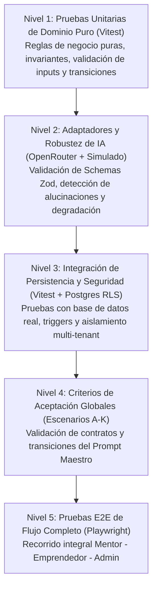
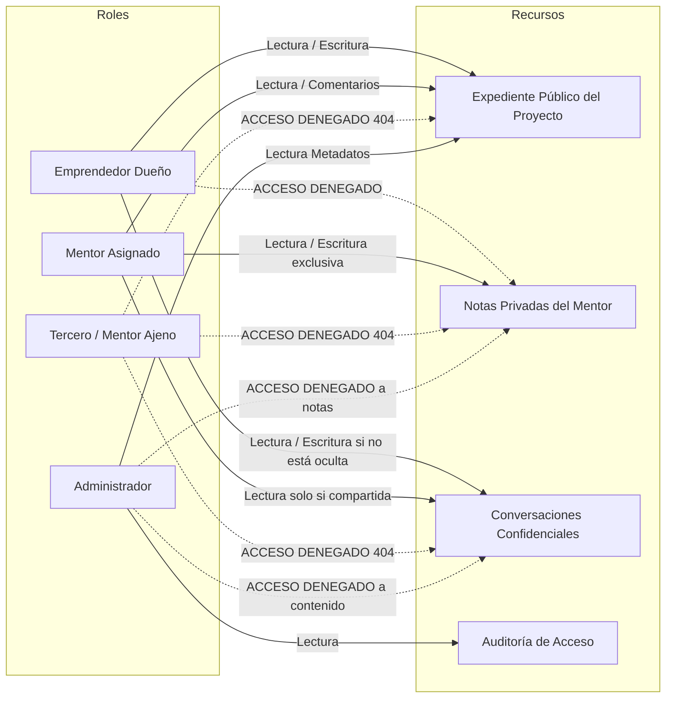
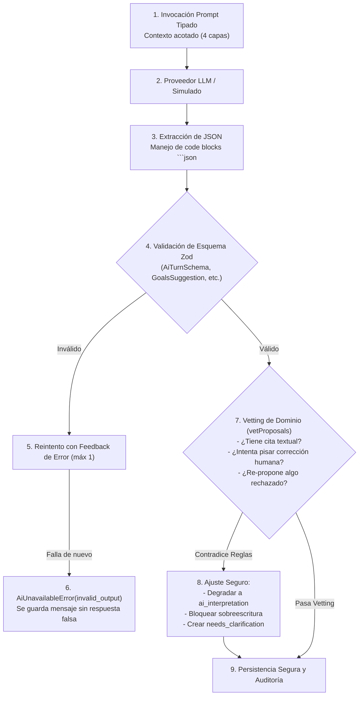

# RAX — Plan Maestro de Pruebas y Aseguramiento de Calidad

> **Documento de Referencia de Calidad**  
> **Versión:** 1.0.0  
> **Ámbito:** Validación funcional, técnica, de IA, de seguridad y de impacto del sistema RAX frente al Prompt Maestro de Mentoría Inteligente.

---

## 1. Objetivos y Alcance del Plan de Pruebas

El objetivo principal de este plan es **demostrar con evidencia reproducible y verificable** que la plataforma RAX cumple rigurosamente con los principios, arquitectura y flujos de negocio definidos en el *Prompt Maestro de Mentoría Empresarial con Swarm de IA*.

### 1.1. Objetivos Específicos
1. **Validar los 6 Principios Fundamentales del Producto:**
   - La mentoría es el eje central (no un CRM genérico ni un mero chatbot).
   - El mentor conserva su criterio profesional (la IA propone, el humano decide y aprueba).
   - No todo es un experimento (intervenciones multimodales: tareas, habilidades, decisiones, especialistas).
   - Conservación inmutable del contexto a lo largo de todo el ciclo de vida.
   - Automatización con valor real y sin fricción administrativa artificial.
   - Separación estricta y tipada entre evidencia, afirmación, hipótesis e interpretación de IA.
2. **Validar las 7 Etapas del Ciclo de Mentoría:**
   - Etapa 1: Exploración, química y compatibilidad (sin forzar programas prematuros).
   - Etapa 2: Diagnóstico progresivo, multidimensional y editable.
   - Etapa 3: Objetivos versionables con línea base y acuerdos de mentoría bilaterales.
   - Etapa 4: Hoja de ruta multimodal con hitos y dependencias.
   - Etapa 5: Ciclo de sesiones continuo (briefing pre-sesión, registro en vivo y resumen pos-sesión).
   - Etapa 6: Accountability contextual y feedback no culpabilizante.
   - Etapa 7: Evaluación de resultados contra línea base, cierre y renovación sin pérdida de historia.
3. **Verificar los 11 Escenarios Globales de Aceptación (Escenarios A–K).**
4. **Garantizar la Seguridad, Privacidad y Aislamiento Multi-Tenant (RLS en PostgreSQL).**
5. **Verificar la Resiliencia y Contratos de IA (Fallback, degradación limpia y prevención de alucinaciones).**
6. **Medir la Viabilidad del Piloto (KPIs de reducción de carga administrativa y trazabilidad ≥90%).**

---

## 2. Matriz de Auditoría y Brechas (Gap Analysis vs Código Actual)

| Sección del Prompt Maestro | Requisito Clave | Estado Actual en Repositorio | Pruebas Existentes | Brecha a Cubrir en el Plan |
|---|---|---|---|---|
| **§ 1 & § 2: Principios** | Evidencia vs Interpretación; Criterio del Mentor; Contexto inmutable | **IMPLEMENTED** | `tests/scenarios.test.ts` (Esc. B, C, D) | Expandir a intervenciones no experimentales en UI |
| **§ 5: Etapa 1** | Exploración y decisión de compatibilidad sin programa forzado | **IMPLEMENTED** | `tests/mentorship-relation.test.ts` (Esc. A) | Verificar persistencia en UI y sesión exploratoria única |
| **§ 5: Etapa 2** | Diagnóstico 9 dimensiones, editable, incógnitas "no sé" | **IMPLEMENTED** | `tests/scenarios.test.ts` (Esc. A, B, D) | Pruebas de exportación de snapshots de diagnóstico |
| **§ 5: Etapa 3** | Acuerdos bilaterales versionados + Objetivos con línea base | **IMPLEMENTED** | `tests/mentorship-relation.test.ts` (Esc. B) | Validar cambios de acuerdo a mitad de programa |
| **§ 5: Etapa 4** | Hoja de ruta multimodal (hitos, tareas, decisiones, experimentos) | **PARTIAL** | Tareas de experimentos en `tests/hypotheses-ai.test.ts` | Integrar hitos no experimentales (skills, decisiones) |
| **§ 5: Etapa 5** | Ciclo de sesiones: Pre-sesión (briefing), Intra y Pos-sesión | **PARTIAL** | 1ª/2ª revisión en `tests/scenarios.test.ts` y `mentoring-ai.test.ts` | Automatizar briefing periódico entre sesiones continuas |
| **§ 5: Etapa 6** | Accountability: compromisos, bloqueos, causas hipotéticas | **PARTIAL** | Tablero de tareas en `/tareas` | Detección automatizada de causas de retraso sin culpa |
| **§ 5: Etapa 7** | Evaluación vs línea base, 3 rutas de cierre/renovación | **PARTIAL** | Modelo en `MentorshipRelation` | Flujo E2E de cierre formal y comparación contra baseline |
| **§ 6: Chat Contextual** | Memoria en 4 capas (Permanente, Operativa, Histórica, Puntual) | **PARTIAL** | `buildInterviewContext` acotado | Chat multidimensional con referencias activas a acuerdos |
| **§ 7: Productividad Mentor** | Bandeja «Mi próxima intervención» con estructura causal | **PLANNED** | Algoritmo de bandeja en `inbox.ts` | Casos de prueba de scoring de urgencia y sugerencias |
| **§ 8: Biblioteca Recursos** | Frameworks, plantillas y ejercicios contextuales | **PLANNED** | Esquema base en tipos | Prueba de recomendación contextual sin fuga de datos |
| **§ 9: Diagnóstico/Experimentos** | Hipótesis y experimentos con criterios bloqueados al inicio | **IMPLEMENTED** | `tests/scenarios.test.ts` (Esc. E), `hypotheses-ai.test.ts` | Validar casos donde NO se requiere experimento |
| **§ 10: Arquitectura de IA** | Interfaces desacopladas, tipado estricto Zod, resiliencia a 429 | **IMPLEMENTED** | `tests/scenarios.test.ts` (Esc. G), `lib/ai/openrouter.ts` | Pruebas de carga y variabilidad de prompts |
| **§ 11: Modelo de Datos** | Entidades relacionales, snapshots y auditoría de eventos | **IMPLEMENTED** | Migraciones SQL + `audit_events` | Pruebas de integridad referencial y snapshots históricos |
| **§ 12: Seguridad y RLS** | Doble cliente Supabase, aislamiento de inquilinos y notas privadas | **IMPLEMENTED** | `tests/scenarios.test.ts` (Esc. F), `test:db`, `test:pg` | Verificación de notas privadas del mentor invisibles para emprendedor |
| **§ 15: Criterios Globales** | Escenarios A hasta K | **75% IMPLEMENTED** | Escenarios A, B, C, D, E, F, G, H cubiertos | Completar Escenarios I (Cierre/Renovación), J y K formales |

---

## 3. Pirámide y Niveles de Prueba



---

## 4. Batería de Pruebas Detallada: Las 7 Etapas del Proceso de Mentoría

### Etapa 1 — Exploración, Química y Compatibilidad

#### Caso TEST-ET1-01: Exploración preliminar sin compromiso contractual forzado
- **Propósito:** Confirmar que el registro de una necesidad inicial o una conversación exploratoria no crea automáticamente un programa formal, tareas recurrentes u objetivos vinculantes.
- **Precondiciones:** Emprendedor registrado con un proyecto en estado inicial. Mentor disponible asignado para sesión exploratoria.
- **Pasos:**
  1. Iniciar relación de mentoría en etapa `exploration` vía `initiateMentorshipRelation`.
  2. Registrar notas exploratorias de expectativas y áreas de especialidad.
  3. Comprobar el estado de la relación (`compatibilityStatus = 'pending'`, `stage = 'exploration'`).
  4. Comprobar que NO existen objetivos creados en `mentorship_goals` ni acuerdos activos en `mentorship_agreements`.
- **Criterio de Éxito:** La relación permanece en modo exploratorio; la base de datos no contiene compromisos vinculantes ni tareas automáticas.

#### Caso TEST-ET1-02: Declinación mutua o unilateral respetuosa y trazable
- **Propósito:** Validar que si no hay química o alineación de especialidad, la relación puede cerrarse registrando la justificación sin borrar el expediente inicial.
- **Pasos:**
  1. El mentor o emprendedor ejecuta `decideCompatibility(relId, 'declined', rationale)`.
  2. Verificar que `compatibilityStatus` pasa a `'declined'` y `stage` a `'closed'`.
  3. Verificar que se emite el evento de auditoría `mentorship.compatibility_decided` con los metadatos de la razón.
  4. Intentar forzar una transición a `agreement` o `active_mentoring`.
- **Criterio de Éxito:** La relación queda archivada limpiamente; transiciones posteriores son rechazadas con `invalid_transition`; el historial del proyecto se preserva.

---

### Etapa 2 — Diagnóstico y Punto de Partida

#### Caso TEST-ET2-01: Tipificación estricta de fuentes (Hecho vs Declaración vs Hipótesis vs IA)
- **Propósito:** Asegurar que el sistema clasifica inequívocamente el origen de cada hallazgo y no permite que una interpretación de IA se presente como hecho observado.
- **Pasos:**
  1. El emprendedor envía mensajes a la conversación con afirmaciones explícitas ("vendemos a $50"), suposiciones ("creo que les gusta el empaque") e incógnitas ("no sé cuál es el costo unitario").
  2. Procesar con `vetProposals`:
     - La afirmación con cita literal debe tener `infoType = 'entrepreneur_statement'`.
     - La deducción de la IA sin cita literal exacta debe degradarse a `infoType = 'ai_interpretation'`.
     - El desconocimiento debe registrarse con `infoType = 'unknown'` y `category = 'open_question'`.
- **Criterio de Éxito:** Ninguna afirmación carente de cita se etiqueta como declaración literal.

#### Caso TEST-ET2-02: Inmutabilidad histórica ante correcciones humanas
- **Propósito:** Confirmar que cuando el emprendedor o mentor corrige un elemento, la versión previa queda intacta en `diagnosis_item_history` y la IA queda inhibida para sobreescribirla.
- **Pasos:**
  1. Crear un `DiagnosisItem` con contenido inicial y versión 1.
  2. Ejecutar `changeItem` con nuevo contenido (pasa a versión 2 y estado `corrected`).
  3. Verificar que `diagnosis_item_history` almacena la tupla `{ before, after, changedBy, timestamp }`.
  4. La IA intenta actualizar dicho elemento mediante una propuesta posterior.
- **Criterio de Éxito:** El motor `vetProposals` bloquea la actualización sobre el elemento corregido (`protected = true`) y exige crear un elemento nuevo si amerita.

---

### Etapa 3 — Objetivos de Mentoría y Acuerdos de Trabajo

#### Caso TEST-ET3-01: Confirmación bilateral obligatoria del acuerdo de trabajo
- **Propósito:** Validar que los acuerdos de trabajo (frecuencia, canales, alcance, compromisos y confidencialidad) requieren aceptación explícita de ambas partes antes de regir la relación.
- **Pasos:**
  1. El mentor redacta los términos del acuerdo (`saveMentorshipAgreement` en estado `draft`).
  2. El mentor confirma el acuerdo (`confirmMentorshipAgreement`). Estado resultante: `confirmed_by_mentor`.
  3. Verificar que la relación aún NO avanza a `active_mentoring`.
  4. El emprendedor confirma el acuerdo. Estado resultante: `active`.
  5. Verificar que la relación avanza automáticamente a `stage = 'active_mentoring'`.
- **Criterio de Éxito:** Ninguna parte puede imponer unilateralmente un acuerdo sin la confirmación de la contraparte.

#### Caso TEST-ET3-02: Formulación de objetivos con línea base explícita y tipos cualitativos/cuantitativos
- **Propósito:** Asegurar que los objetivos incorporan obligatoriamente el punto de partida (`baseline`), el resultado esperado (`targetResult`) y su justificación (`whyItMatters`), admitiendo tanto métricas duras como desarrollo de capacidades o decisiones cualitativas.
- **Pasos:**
  1. Registrar un objetivo métrico: `kind = 'metric'`, indicador definido, baseline documentada.
  2. Registrar un objetivo cualitativo: `kind = 'capability'`, sin forzar métricas numéricas artificiales.
  3. Intentar crear un objetivo con `baseline` vacía o descripción insuficiente.
- **Criterio de Éxito:** Validación Zod rechaza descripciones ambiguas; la base de datos persiste ambos tipos de objetivos vinculados al diagnóstico.

---

### Etapa 4 — Hoja de Ruta y Plan de Acción Multimodal

#### Caso TEST-ET4-01: Tipología multimodal de intervenciones (No todo es experimento)
- **Propósito:** Comprobar que RAX soporta planes de acción con diversas naturalezas operativas y estratégicas:
  - Acción operativa concreta (trámite, registro, contratación).
  - Aprendizaje o adquisición de habilidades (capacitación en finanzas o ventas).
  - Decisión estratégica pendiente (elegir proveedor o modelo de cobro).
  - Revisión con el mentor o consulta con especialista externo.
  - Experimento o validación empírica (solo cuando existe incertidumbre comprobable).
- **Pasos:**
  1. Crear acciones asignadas a un objetivo con distintos `actionKind`.
  2. Verificar que las acciones operativas no exigen métricas ni criterios de rechazo.
  3. Verificar que las acciones de tipo experimento sí exigen hipótesis asociada y diseño metodológico.
- **Criterio de Éxito:** El sistema no fuerza a crear hipótesis para tareas operativas o de capacitación directa.

#### Caso TEST-ET4-02: Trazabilidad bidireccional entre Acciones, Hitos y Objetivos
- **Propósito:** Validar que ninguna tarea quede huérfana en el sistema como una "to-do list" aislada sin anclaje en los objetivos del proceso de mentoría.
- **Pasos:**
  1. Crear una tarea vinculada a un hito y a un `mentorshipGoalId`.
  2. Cambiar el estado del objetivo a `deferred` o `discarded`.
  3. Consultar las tareas activas en el tablero.
- **Criterio de Éxito:** Las tareas reflejan el estado del objetivo padre y señalan la necesidad de revisión en la hoja de ruta.

---

### Etapa 5 — Ejecución y Ciclo de Sesiones

#### Caso TEST-ET5-01: Preparación previa (Briefing automático contextual)
- **Propósito:** Verificar que antes de cada sesión el mentor recibe un briefing consolidado generado a partir de las 4 capas de contexto sin necesidad de leer manualmente todas las conversaciones previas.
- **Pasos:**
  1. Configurar un proyecto con compromisos cumplidos, un compromiso vencido y un bloqueo documentado.
  2. Invocar la generación de briefing pre-sesión.
  3. Comprobar que el briefing contiene:
     - Estado de los objetivos prioritarios.
     - Compromisos completados vs vencidos.
     - Bloqueos identificados.
     - Propuesta de preguntas clave y temas para la agenda.
     - Señalización explícita de datos desactualizados o faltantes.
- **Criterio de Éxito:** El briefing resalta puntos críticos en menos de 2 páginas de lectura sin alucinaciones numéricas.

#### Caso TEST-ET5-02: Propuestas pos-sesión revisables (La IA propone, el mentor aprueba)
- **Propósito:** Validar que las notas y acuerdos tomados durante la sesión generan borradores de compromisos y tareas que requieren revisión humana antes de ser definitivos.
- **Pasos:**
  1. El mentor registra notas de la sesión (`SessionNote`: preguntas, observaciones, acuerdos).
  2. Invocar la asistencia pos-sesión de IA (`suggestFirstReview` / `suggestSessionWrapUp`).
  3. La IA devuelve propuestas de acuerdos y tareas recomendadas.
  4. Verificar que se crean en estado `proposed` o `draft`.
  5. El mentor edita y confirma las notas y tareas seleccionadas.
- **Criterio de Éxito:** Ninguna propuesta de la IA se convierte automáticamente en compromiso contractual sin aprobación explícita.

---

### Etapa 6 — Accountability y Feedback Proporcional

#### Caso TEST-ET6-01: Detección y contextualización de compromisos vencidos
- **Propósito:** Confirmar que cuando una tarea o compromiso vence, el sistema ayuda a diagnosticar la causa subyacente sin emitir mensajes culpabilizantes o punitivos.
- **Pasos:**
  1. Crear un compromiso con fecha límite anterior a la fecha actual.
  2. Ejecutar la revisión de accountability.
  3. Verificar que el sistema categoriza las posibles hipótesis de retraso:
     - Falta de claridad en la definición.
     - Restricción de tiempo o recursos.
     - Dependencia externa bloqueante.
     - Cambio imprevisto de prioridades.
     - Dificultad técnica de ejecución.
  4. Verificar que el texto de notificación al emprendedor es constructivo y orientador.
- **Criterio de Éxito:** Cero términos punitivos o estigmatizantes; la causa se registra como hipótesis pendiente de confirmación en la siguiente sesión.

---

### Etapa 7 — Evaluación de Resultados, Cierre y Renovación

#### Caso TEST-ET7-01: Comparativa estructurada contra la línea base
- **Propósito:** Validar que al evaluar el ciclo de mentoría se contrasta el estado final alcanzado contra el diagnóstico inicial y la línea base registrada en la Etapa 3.
- **Pasos:**
  1. Configurar un proyecto con línea base inicial documentada ("0 clientes, sin modelo financiero").
  2. Registrar evidencias obtenidas y estado de los objetivos al cabo del periodo.
  3. Generar la evaluación de resultados:
     - Contraste explícito entre `baseline` y `targetResult` vs `observedResult`.
     - Identificación de objetivos logrados, parcialmente logrados y no logrados.
     - Distinción entre volumen de actividad (tareas hechas) y resultados reales comprobados.
- **Criterio de Éxito:** La evaluación prohíbe declarar un objetivo como "cumplido" si carece de evidencia empírica vinculada.

#### Caso TEST-ET7-02: Ejecución de las 3 rutas de continuidad preservando el archivo histórico
- **Propósito:** Verificar que el cierre de una etapa no destruye la información y permite seleccionar limpiamente entre:
  1. Cierre formal con plan de continuidad y autonomía documentado.
  2. Renovación del programa con actualización de acuerdos y nuevos objetivos.
  3. Nueva etapa enfocada en desafíos distintos (ej. de validación a escala).
- **Pasos:**
  1. Ejecutar `transitionMentorshipStage` hacia `closed` o `renewed`.
  2. Comprobar que todas las sesiones previas, notas, diagnósticos históricos y evidencias permanecen consultables en modo solo lectura para ambas partes.
  3. En caso de renovación, verificar que se inicializa una nueva versión de acuerdos sin sobrescribir los anteriores.
- **Criterio de Éxito:** Integridad histórica del 100%; los acuerdos pasados conservan su estado `superseded` o `archived`.

---

## 5. Matriz de Pruebas de los Criterios de Aceptación Globales (Escenarios A–K)

La siguiente tabla operacionaliza los 11 escenarios obligatorios de la Sección 15 del Prompt Maestro:

| Escenario | Nombre | Objetivo de Prueba | Entrada / Condición | Resultado Esperado | Prueba Automatizada |
|---|---|---|---|---|---|
| **A** | **Primera relación** | El emprendedor expone su necesidad y ambas partes deciden si continúan sin forzar un programa. | Entrevista inicial con incertidumbre, sin acuerdos previos. | Decisión explícita (`proceed` o `declined`); si es `declined`, la relación se cierra limpiamente sin crear programa formal. | `tests/mentorship-relation.test.ts` (it 1) |
| **B** | **Acuerdos y objetivos** | Registro formal y versionado de acuerdos de trabajo y objetivos con línea base. | Términos de trabajo, periodicidad y 3 objetivos cualitativos/cuantitativos. | Confirmación obligatoria por ambas partes; las modificaciones generan versión N+1 manteniendo el historial. | `tests/mentorship-relation.test.ts` (it 2) |
| **C** | **Preparación de sesión** | El mentor recibe un briefing contextualizado con compromisos, bloqueos y decisiones pendientes. | Solicitud de sesión tras periodo inter-sesión con actividad. | Briefing automático generado con procedencia explícita y 4 capas de memoria; sin necesidad de leer todos los chats. | `tests/scenarios.test.ts` (Esc. C) & `tests/mentoring-ai.test.ts` |
| **D** | **Sesión y seguimiento** | Las notas y acuerdos de la sesión se convierten en propuestas revisables de tareas vinculadas a objetivos. | Notas de sesión registradas por el mentor (`question`, `observation`, `agreement`). | La IA sugiere compromisos tipados; el mentor edita/aprueba; quedan vinculados a objetivos de mentoría. | `tests/mentoring-ai.test.ts` & `tests/scenarios.test.ts` |
| **E** | **Chat contextual** | El asistente de IA responde usando datos autorizados del expediente y reconoce vacíos. | Pregunta del usuario sobre cifras o acuerdos no registrados en el expediente. | La IA responde citando fuentes del expediente; si el dato no existe, declara desconocimiento ("no está registrado"). | `tests/scenarios.test.ts` (Esc. A, D) |
| **F** | **Accountability sin culpa** | El sistema detecta compromisos vencidos y sugiere causas hipotéticas sin juzgar. | Tarea con fecha límite vencida. | Notificación proporcional; categorización de posibles causas (falta de tiempo, dependencia, etc.) como hipótesis. | `tests/scenarios.test.ts` (Esc. E) + nueva prueba unitaria |
| **G** | **Diagnóstico y experimentación** | Un problema se convierte en hipótesis y experimento solo cuando hay incertidumbre que lo amerite. | Problema priorizado con supuesto de alto riesgo vs problema operativo directo. | Criterios de éxito y rechazo bloqueados al iniciar (`criteriaLockedAt`); el sistema no fuerza experimento si no aplica. | `tests/scenarios.test.ts` (Esc. E) & `tests/hypotheses-ai.test.ts` |
| **H** | **Evaluación objetiva** | Comparativa de resultados vs línea base sin declarar éxito falso por mera actividad. | Experimento o ciclo completado con resultado negativo o mixto. | Resultado negativo debilita la hipótesis (`weakened`); no se declara éxito solo por haber completado las tareas. | `tests/scenarios.test.ts` (Esc. E) |
| **I** | **Cierre y renovación** | Conclusión o renovación del proceso conservando el histórico íntegro. | Transición a etapa final de evaluación. | El expediente anterior pasa a consulta histórica; se habilita la creación de nuevo ciclo o plan de continuidad. | `tests/mentorship-relation.test.ts` (it 2) |
| **J** | **Seguridad y aislamiento** | Bloqueo absoluto de acceso a notas privadas, conversaciones y proyectos de terceros. | Solicitudes directas con credenciales de otro emprendedor, mentor no asignado o admin. | Retorno estricto de `not_found` (para no filtrar existencia); auditoría de evento `access.denied`; RLS en DB. | `tests/scenarios.test.ts` (Esc. F) |
| **K** | **Resiliencia ante fallos de IA** | Ante caída de API externa (429, 500 o JSON inválido), no se pierden datos y la app sigue utilizable. | OpenRouter simulando timeout, rate limit (429) o JSON truncado. | El mensaje del usuario se guarda intacto; se notifica el fallo limpiamente; cero respuestas alucinadas; reintento limpio. | `tests/scenarios.test.ts` (Esc. G) |

---

## 6. Pruebas de Seguridad, Privacidad y Autorización (RLS)

### 6.1. Aislamiento Multi-Tenant y Control de Acceso


#### Pruebas de Seguridad Críticas a Ejecutar:
1. **TEST-SEC-01 (Invisibilidad de notas privadas):** Verificar por consulta SQL directa como rol `authenticated` (con uid del emprendedor) que `SELECT * FROM session_notes WHERE is_private = true` devuelve 0 filas mediante RLS.
2. **TEST-SEC-02 (Defensa en profundidad contra IDOR):** Intentar acceder a `/app/p/[id_ajeno]` manipulando UUIDs en la URL. El servidor debe responder con `DomainError: not_found` y registrar el intento en `audit_events`.
3. **TEST-SEC-03 (Privacidad de transcripciones y chat):** Si el emprendedor tiene `shareConversationWithMentor = false`, el mentor asignado solo tiene acceso al diagnóstico y al briefing consolidado, quedando bloqueada la lectura de mensajes crudos.
4. **TEST-SEC-04 (Protección de credenciales y sanitización):** Comprobar que en ninguna tabla de la base de datos, archivo de logs o respuesta de error se expongan `OPENROUTER_API_KEY`, `SUPABASE_SECRET_KEY` o prompts completos con datos sensibles.

---

## 7. Pruebas de IA, Memoria Contextual y Mitigación de Alucinaciones

### 7.1. Arquitectura de Verificación de Salidas de IA
Cada invocación a un proveedor de IA (sea simulado u OpenRouter) debe someterse a la siguiente tubería de verificación obligatoria:



#### Pruebas Específicas de IA:
1. **TEST-AI-01 (Detección de alucinación numérica):** Alimentar una conversación donde el emprendedor nunca menciona montos de venta o costos. Comprobar que el diagnóstico generado contiene 0 números o estimaciones financieras inventadas.
2. **TEST-AI-02 (Degradación ante ausencia de cita literal):** Una propuesta generada con `infoType = 'entrepreneur_statement'` cuya cita no se encuentre idéntica en el texto del mensaje original debe ser degradada inmediatamente a `ai_interpretation` con cita nula.
3. **TEST-AI-03 (Manejo de saturación de API 429 y fallback):** Simular respuesta 429 en el modelo primario de OpenRouter. Verificar que el adaptador pasa automáticamente al modelo de respaldo configurado y registra el uso del modelo alternativo.

---

## 8. Pruebas de Rendimiento, Concurrencia y Resiliencia

### 8.1. Control de Concurrencia Optimista
- **Caso TEST-PERF-01:** Dos usuarios (ej. mentor y emprendedor en simultáneo) abren el mismo elemento de diagnóstico con versión 3.
  - El usuario A guarda una priorización (el elemento pasa a versión 4).
  - El usuario B intenta enviar una edición con versión esperada 3.
  - **Resultado Esperado:** La petición del usuario B es rechazada con código `conflict` (HTTP 409). El contenido guardado por el usuario A no se corrompe.

### 8.2. Resiliencia de Red y Caídas de Conectividad
- **Caso TEST-PERF-02:** El usuario envía una nota o actualiza una tarea cuando la conexión con Supabase o el backend experimenta un corte de red.
  - **Resultado Esperado:** La interfaz muestra un aviso de error claro sin perder el borrador introducido en el formulario; reintentar la acción tras restablecer la conexión completa la persistencia limpiamente.

---

## 9. Medición de Impacto del Piloto (Sección 16 del Prompt Maestro)

Para autorizar el paso a piloto real, se deben instrumentar y validar los siguientes indicadores:

| Indicador del Piloto | Meta de Diseño | Método de Verificación en Pruebas |
|---|---|---|
| **Reducción de Tiempo Administrativo del Mentor** | ≥ 25% respecto a línea base tradicional | Medir tiempo de generación de briefing y actas pos-sesión vs redacción manual. |
| **Trazabilidad de Decisiones y Acuerdos** | ≥ 90% de decisiones vinculadas a objetivos | Consulta analítica en `audit_events` y `decisions`: ratio de decisiones con `relatedGoalId` no nulo. |
| **Cierre de Etapa Documentado** | ≥ 90% con evaluación y plan de continuidad | Ratio de relaciones en estado `closed` o `renewed` con `EvaluationSummary` completado. |
| **Separación de Evidencia vs Interpretación** | 100% de elementos de IA clasificados | Verificación estricta de que ningún elemento creado por IA tenga `infoType = 'documented_observation'`. |

---

## 10. Procedimiento de Ejecución y Criterios de Aceptación (Definition of Done)

### 10.1. Comandos de Verificación Automatizada

```bash
# 1. Comprobación de tipos TypeScript estricto
npm run typecheck

# 2. Análisis estático y reglas de código
npm run lint

# 3. Batería completa de pruebas de dominio y escenarios en memoria
npm test

# 4. Pruebas de escenarios contra PostgreSQL 16 real con RLS y Triggers
npm run test:pg

# 5. Verificación de migraciones y funciones de base de datos
npm run test:db
```

### 10.2. Criterios de Aceptación para Paso a Producción / Piloto (Gateways de Calidad)
- [ ] **100% de pruebas pasando:** 0 pruebas fallidas en `npm test` y `npm run test:pg`.
- [ ] **TypeScript Estricto:** `tsc --noEmit` completado sin advertencias ni errores.
- [ ] **Aislamiento Multi-Tenant comprobado:** Pruebas de RLS ejecutadas contra PostgreSQL sin omisiones de seguridad.
- [ ] **Integridad Histórica:** Ninguna operación de base de datos ejecuta `DELETE` destructivo sobre expedientes, acuerdos o auditoría.
- [ ] **Transparencia de IA:** Cada interacción con IA indica claramente su modelo/proveedor o estado de simulación.
